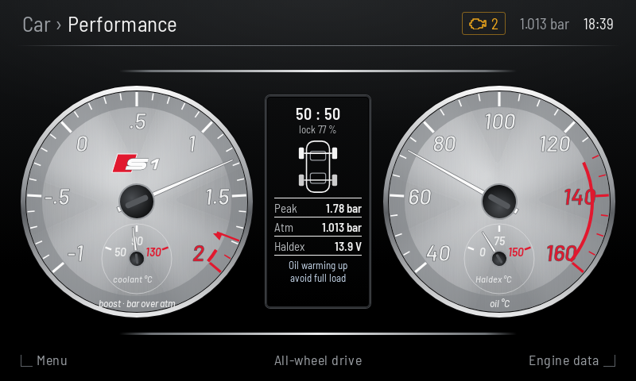
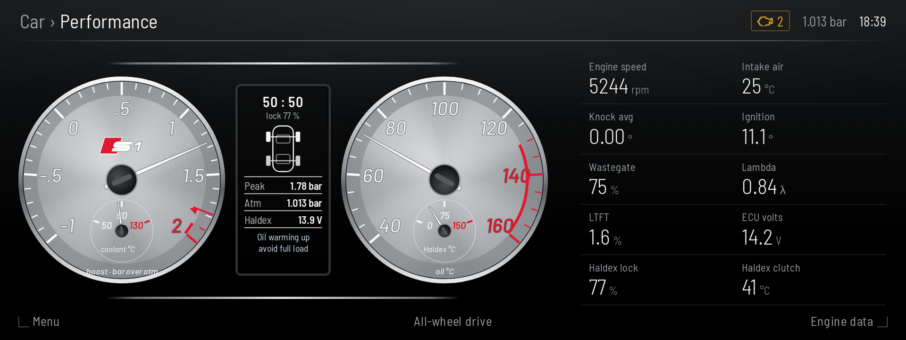
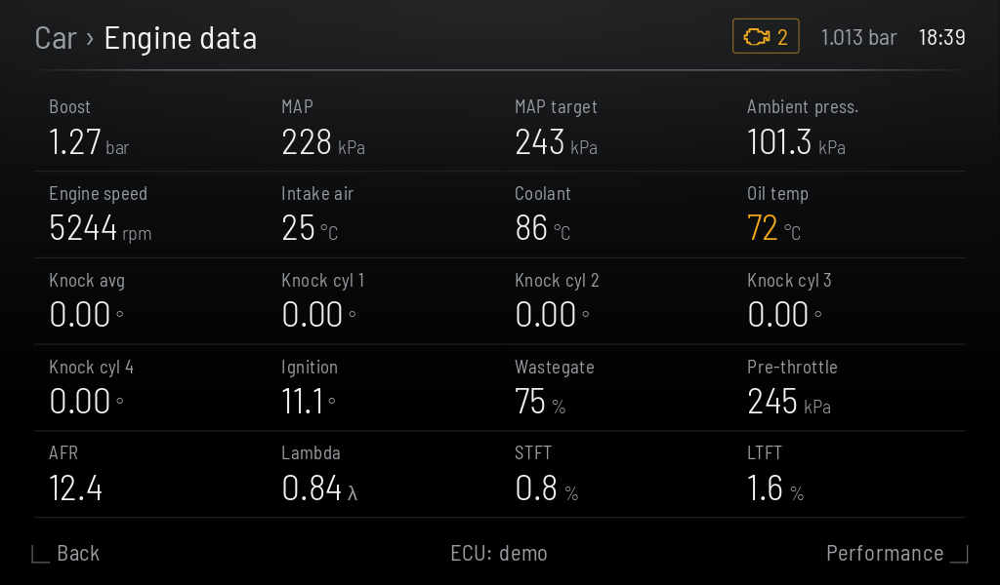
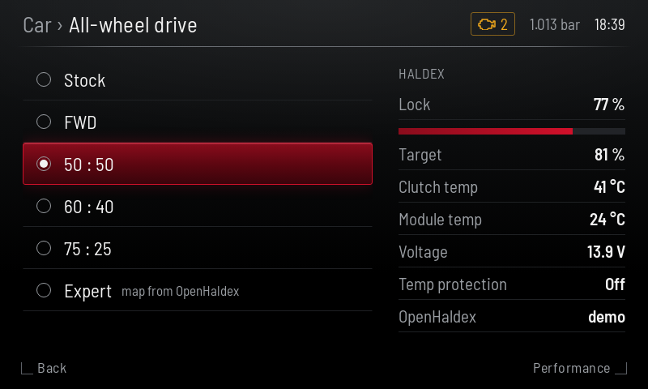
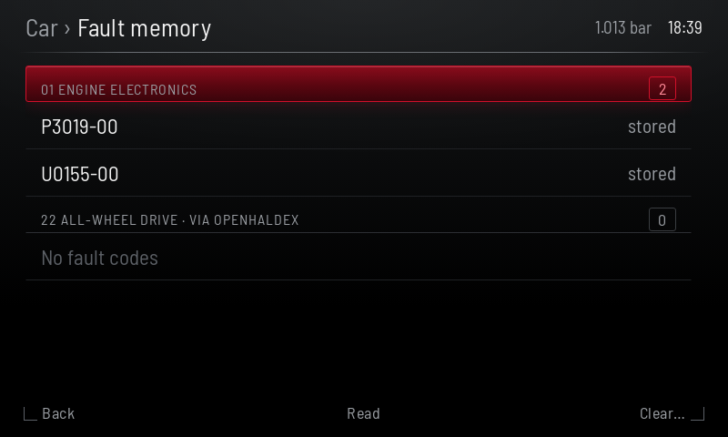
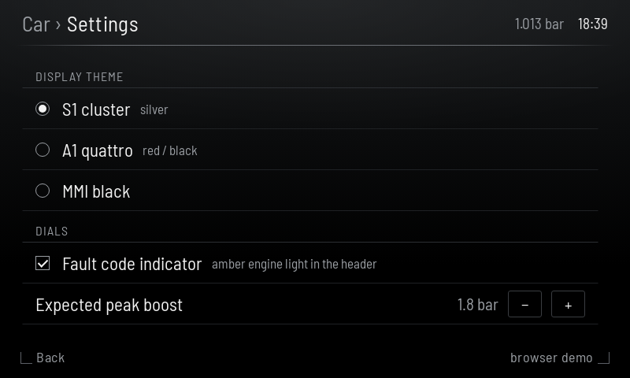

# S1-Dash

An in-car dashboard for the Audi S1 / A1 (8X, PQ25) that runs on an Android
head unit, styled like the car's own instrument cluster and MMI, so it reads
as OEM+.

- **Gauges**: boost (manifold pressure minus atmospheric, with a peak-hold mark and your expected peak marked),
  oil temp, coolant, Haldex clutch temp, Haldex lock, mode and voltage.
- **Engine data**: the same live set SimosTools logs: MAP and target, ambient, IAT, knock per cylinder,
  timing, wastegate, AFR / lambda, trims, fuel pressures, turbo speed and more.
- **Haldex**: switch OpenHaldex modes from the screen; clutch / module temps, voltage, temperature protection.
- **Fault codes**: an amber engine-light indicator (can be turned off), read and clear engine and Haldex codes.
- **Data logger**: CSV at 10 Hz on the head unit's storage.
- **Open SimosTools** from the menu; the app lets go of the dongle and takes it back when you return.

## Screens

| Performance (S1 theme, 800×480) | Wide screen (1920×720) |
|---|---|
|  |  |

| Engine data | All-wheel drive | Fault memory | Settings |
|---|---|---|---|
|  |  |  |  |

Portrait screens stack the full engine data set under the dials:
[A1 quattro theme, 1080×1920](docs/screens/perf-portrait.png). Themes: **S1 cluster**, **A1 quattro**, **MMI black**.

## Which head units

One APK for all of them (Android 9 and newer):

- **MITM box behind the original fold-down screen** (Android 9).
- **Carlinkit T-Box style boxes** (Android 13), which can hold several Bluetooth links at once.
- **Big replacement screens** (10", 13", landscape or portrait) and **phones** mirrored to the car's screen.

The UI is laid out for 480 logical pixels of height and scales to the screen.
Wider screens get an extra column of engine data, and portrait screens stack it under the dials.

## Where the data comes from

| Data | Source | Notes |
|---|---|---|
| Haldex mode, lock, clutch / module temp, voltage, codes | [OpenHaldex-C6](https://github.com/louij2/OpenHaldex-C6) over its Wi-Fi (default `192.168.1.1`) | Turn on **Enable Live Diagnostics** in OpenHaldex for the temps and voltage. |
| Engine data (boost, oil, coolant, knock, …) and engine codes | The Simos18 ECU through a Bluetooth dongle | **SimosTools dongle** (BLE ISO-TP bridge, found by name `BLE_TO_ISOTP20` or by MAC), or an **ELM327** dongle by MAC, for example the steering wheel's while the wheel is switched off. |
| Demo mode | Built in | Made-up readings, for trying it without the car. |

Only one app can use a dongle at a time. The ELM327 path asks for one value per
request, because clone ELMs mangle multi-frame replies; reading the full engine
code list needs the SimosTools dongle.

The ECU identifiers and scaling come from SimosTools' mode-22 list
(Switchleg1/SimosTools, `PID/PIDList22-USA.csv`), converted to metric.

## Install

1. Download `S1-Dash-<version>.apk` from the [latest release](https://github.com/louij2/S1-Dash/releases/latest).
2. Get it onto the head unit: download it there, or copy it to a **FAT32** USB stick
   (many head units can't read exFAT) and open it with the file manager.
   Allow "install unknown apps" when asked.
3. Open **S1 Dash** and allow Bluetooth (and Location on Android 9) when asked.
4. **Menu › Settings**:
   - **OpenHaldex**: on, address `192.168.1.1`, and join the head unit to the controller's Wi-Fi.
   - **Engine ECU**: pick the dongle type, then **Choose…** to pick it from the paired Bluetooth devices
     (pair it in Android's Bluetooth settings first).
   - No car handy? Turn on **Demo mode**.

New versions install over the old one and keep your settings.
For the "Open SimosTools" button, install [SimosTools](https://github.com/Switchleg1/SimosTools) as well.

## Build

```sh
./gradlew assembleDebug     # app/build/outputs/apk/debug/app-debug.apk
```

JDK 17 and the Android SDK (API 34). The UI is plain HTML/JS in
`app/src/main/assets/ui/` and also runs in a desktop browser with demo data:
open `index.html?screen=perf&theme=s1`. CI builds a debug APK on every push.
Signed releases come from `scripts/release.sh`; the release key is not in the
repo, so builds you make yourself won't install over an official release
(uninstall it first).

Design notes: [docs/DESIGN.md](docs/DESIGN.md). Original mockup: [docs/mockup/](docs/mockup/).

## Disclaimer

A hobby project, not affiliated with or endorsed by Audi AG or the Volkswagen
Group. Audi, S1, A1 and quattro are their trademarks, used here only to say
which cars this is for. Use at your own risk and keep your eyes on the road:
set it up while parked. The app only reads data, apart from changing the
OpenHaldex mode and clearing fault codes, which you ask for on screen.

ECU identifiers and scaling come from
[SimosTools](https://github.com/Switchleg1/SimosTools)' mode-22 list; the
SimosTools dongle protocol is documented there too. Haldex data comes from
[OpenHaldex-C6](https://github.com/louij2/OpenHaldex-C6). Fonts: Barlow and
Barlow Semi Condensed (SIL Open Font License, `app/src/main/assets/ui/fonts/OFL.txt`),
standing in for Audi's own.

## Licence

MIT, see [LICENSE](LICENSE).
